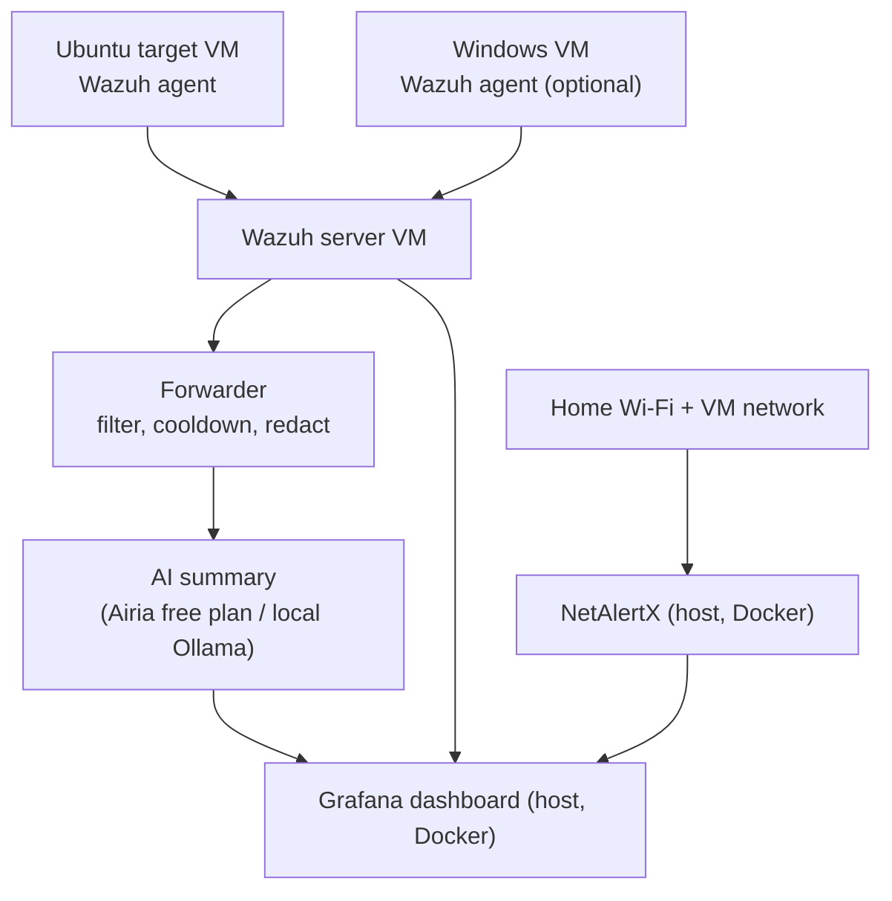

# HomeSOC-AI

A home Security Operations Center (SOC) built on a single Ubuntu host: it watches my lab machines, detects attacks I simulate against them, and uses AI to explain each alert in plain English. Then I measure how accurate the AI actually is.

> **Status:** in progress. Checkboxes below show what is done. Results are filled in only after I have run the tests myself.

## The question this project answers

> Can an AI assistant help one person (or a small team) understand security alerts faster, and how often is it wrong?

Real SOC teams get thousands of alerts a day and cannot read them all. This project is a small, measurable experiment on that problem.

## Architecture



| Component | Where it runs | Job |
|---|---|---|
| Wazuh agents | Ubuntu target VM, Windows VM | Report events from each machine |
| Wazuh server (v4.14.8) | VM on the VMware NAT network | Collects events, raises alerts, maps them to MITRE ATT&CK |
| NetAlertX | Docker on the host, host networking | Lists every device on the home LAN and VM network, flags new ones |
| Grafana | Docker on the host | One dashboard for alerts, devices, and AI summaries |
| Forwarder (Python) | Host | Filters alerts, limits AI calls, masks private data, stores the AI result |
| AI | Airia free plan and/or local Ollama model | Writes a short summary, severity opinion, and next steps for each alert |

**Cost: $0.** Every tool here is free or open source. The AI step can run on a free Airia plan, a local model, or both.

## Goals and how I measure them

| Goal | Measure |
|---|---|
| Detect attacks | Of N simulated attacks, how many did Wazuh catch? |
| Know my network | NetAlertX lists all devices, and known devices are labelled |
| One screen | Grafana shows alerts, devices, and AI summaries together |
| AI helps | Score the AI on 20 alerts against my own triage notes |
| Safe AI use | Private IPs, usernames, and hostnames are masked before leaving the lab |
| Low noise | One AI call per rule per agent per 5 minutes, not one per alert |

## Attack simulations

All attacks run only against my own lab VMs. No brute force.

| # | Attack | MITRE ATT&CK | Target |
|---|---|---|---|
| 1 | New local user added to the sudo group | T1136.001 | Ubuntu |
| 2 | Cron job persistence | T1053.003 | Ubuntu |
| 3 | SSH key planted, then used to log in | T1098.004, T1021.004 | Ubuntu |
| 4 | Log tampering (history and log clearing) | T1070.002, T1070.003 | Ubuntu |
| 5 | Nmap port scan | T1046 | Network |
| 6 | Hidden listening port (backdoor listener) | T1571 | Ubuntu and network |
| 7 | Download-and-run from a server on the host | T1105 | Ubuntu and network |
| 8 | Rogue device joins the network | T1200 (closest match) | NetAlertX |

The Windows VM is optional and not required for these eight.

Details and commands for each attack are in [`attacks/`](attacks/).

## Results

To be filled in after testing.

| # | Detected? | Alert level | MITRE tag correct? | Number of alerts | AI explanation correct? |
|---|---|---|---|---|---|
| 1 | TBD | TBD | TBD | TBD | TBD |

## AI evaluation

Method: take 20 real alerts, write my own triage note for each, then compare with the AI output and label it **correct**, **partly correct**, **wrong**, or **confidently wrong**.

Results: TBD

## Roadmap

- [x] Wazuh server and agents installed
- [ ] Phase 0: VM snapshots, time sync, repo, problems log
- [ ] Phase 1: health baseline for all agents
- [ ] Phase 2: extra monitoring (file integrity, auditd, Sysmon)
- [ ] Phase 3: NetAlertX on host
- [ ] Phase 4: Grafana with read-only Indexer user
- [ ] Phase 5: attack campaign
- [ ] Phase 6: AI forwarder (filter, cooldown, redaction)
- [ ] Phase 7: AI evaluation
- [ ] Phase 8: write-ups and demo video

## Security decisions

- Attacks are run only against VMs I own, inside the lab network.
- Grafana uses a read-only Wazuh Indexer account, never the admin account.
- Alert data is treated as untrusted input to the AI, so the prompt tells it never to follow instructions found inside alert text.
- Private data is masked before any alert is sent to a cloud AI.
- No passwords, API keys, or tokens are committed. Secrets live in local environment files that are ignored by git.
- Known limitation: TLS verification between Grafana and the Indexer is relaxed in the lab. Fixing the certificate is a stretch goal.

## Repository layout

```
docs/          architecture notes and problems log
configs/       Wazuh rules and decoders, compose files, Grafana exports (no secrets)
attacks/       one file per simulated attack
reports/       short incident reports
screenshots/   dashboard and alert screenshots
```

## Problems I solved

See [`docs/problems-log.md`](docs/problems-log.md). Each entry follows the same format: problem, what I tried, fix, lesson.

## Lessons learned

To be written at the end.

## Disclaimer

This is a learning project. Do not run the attack techniques here against systems you do not own or have permission to test.

## Author

[Your name] | [LinkedIn] | [Email]
